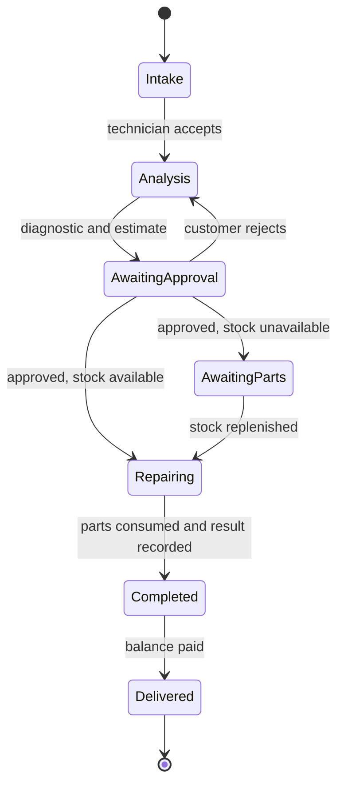

<p align="center">
  
</p>

<p align="center">
  <a href="https://github.com/Zirphaz/zirphas-os/actions/workflows/ci.yml"></a>
  
  
  
  
</p>

# ZirphasOS

ZirphasOS models the workflow of an electronics repair shop, from device intake to paid delivery. The back end uses **FastAPI and PostgreSQL** and keeps estimates, parts, payments, permissions, and order transitions under explicit business rules.

[Setup and API guide](zirphas-os-backend/README.md) · [Application code](zirphas-os-backend/app) · [Tests](zirphas-os-backend/tests) · [Validation record](zirphas-os-backend/docs/VALIDATION.md)

## Why this project exists

Repair shops coordinate reception, technicians, inventory, and payments around the same device. Without a shared workflow, an accepted estimate can change, one part can be consumed twice, or a device can be released before payment. ZirphasOS keeps these decisions in one repair order with controlled state transitions and transactional database operations.

## Main capabilities

- Customer and device intake, including serial numbers, physical checklists, and attachments
- Technician assignment, diagnostic reports, versioned estimates, and customer decisions
- Customer tracking through a private token, without requiring an account
- Inventory validation and transactional part consumption when a repair is completed
- Idempotent partial payments and delivery only after full payment
- Administrative revenue, margin, productivity, and low-stock indicators

| Role | Access |
| --- | --- |
| Administrator | Staff, inventory, assignments, and financial indicators |
| Receptionist | Customers, orders, attachments, payments, receipts, and delivery |
| Technician | Assigned devices, diagnostics, estimates, parts, and repair work |
| Customer | Current order status and estimate decision through a private link |

Staff authentication uses JWT and Argon2 password hashing. Financial cost and margin data is restricted to administrators. Customer tracking tokens are stored as hashes, and issuing a replacement invalidates the previous link.

## Order lifecycle

The [state machine](zirphas-os-backend/app/core/os_state_machine.py) defines allowed transitions. Service methods verify the requirements and apply inventory and financial effects in the same request transaction.



Editing an estimate invalidates its previous approval. Adding a part to an order does not reserve stock; availability is checked again when the repair is completed, and any failure rolls the operation back.

## Financial model

`order result = total price - part cost - commission`

Money uses `Decimal` and PostgreSQL `NUMERIC`. Historical prices and costs remain attached to the order. Payments are internal records; the project does not process bank transactions or issue tax documents.

## Run locally

Requirements: Docker with Compose v2.

```console
cd zirphas-os-backend
cp .env.example .env
docker compose up -d db
docker compose up --build -d api
docker compose exec api python -m app.cli create-admin
```

Set strong, distinct values for `POSTGRES_PASSWORD` and `SECRET_KEY` before starting. Open [Swagger UI](http://localhost:8000/docs) and use the administrator email in the OAuth `username` field. The project does not include a default administrator account or password.

## Validation and current scope

The recorded suite contains **68 passing tests**, including five PostgreSQL scenarios for concurrency and financial integrity. CI applies migrations and runs the suite against PostgreSQL. The [validation record](zirphas-os-backend/docs/VALIDATION.md) separates completed checks from work that still requires a deployment environment.

The current version provides the back-end API and a customer tracking page. Staff operations use Swagger; a dedicated staff dashboard, multi-company isolation, real-time updates, and external notifications remain outside the implemented scope.
