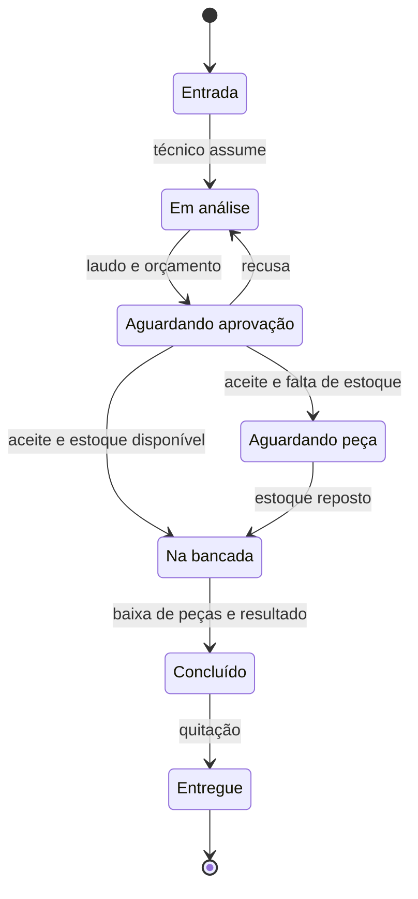

<p align="center">
  
</p>

<p align="center">
  <a href="https://github.com/Zirphaz/zirphas-os/actions/workflows/ci.yml"></a>
  
  
  
  
  
</p>

# ZirphasOS — Smart Repair Management

Gestão de assistência técnica, da entrada do aparelho à entrega paga. Backend em **FastAPI + PostgreSQL**, com controle de acesso por função, aprovação de orçamento, rastreabilidade de peças e resultado financeiro por serviço.

**[Documentação da API e instalação](zirphas-os-backend/README.md)** · **[Código](zirphas-os-backend/app)** · **[Testes](zirphas-os-backend/tests)** · **[Validação registrada](zirphas-os-backend/docs/VALIDATION.md)**

## O problema

Quando bancada e recepção trabalham sem um processo compartilhado, o orçamento pode mudar depois do aceite, uma peça pode ser prometida duas vezes e um aparelho pode sair sem quitação. O ZirphasOS reúne essas decisões em uma ordem de serviço com regras de transição, histórico e operações transacionais no banco.

## Funcionalidades

- **Atendimento:** clientes, aparelhos com IMEI ou número de série, checklist físico e fotos de entrada.
- **Reparo:** atribuição de técnico, laudo, orçamento versionado e peças vinculadas à OS.
- **Portal do cliente:** acompanhamento por link privado e aprovação ou recusa do orçamento, sem cadastro.
- **Estoque:** baixa na conclusão, com validação de disponibilidade e proteção contra consumo concorrente.
- **Financeiro:** pagamentos parciais com idempotência, recibo não fiscal e entrega condicionada à quitação.
- **Gestão:** indicadores administrativos de receita, resultado dos serviços, produtividade e estoque crítico.

| Perfil | Responsabilidade |
| --- | --- |
| Administrador | Funcionários, estoque, atribuição de técnicos e indicadores financeiros. |
| Recepção | Clientes, abertura de OS, fotos, aceite, pagamentos, recibos e entrega. |
| Técnico | Fila de aparelhos, laudos, orçamentos, peças e reparos sob sua responsabilidade. |
| Cliente | Status e decisão sobre a versão atual do orçamento por link privado. |

Funcionários se autenticam com **JWT**; as senhas usam **Argon2**. Custos, comissões e resultados financeiros são restritos ao administrador. O banco armazena somente o hash do token de acompanhamento, e a geração de outro link revoga o anterior.

## Arquitetura e ciclo da OS

O **State Pattern** define as transições permitidas em [`os_state_machine.py`](zirphas-os-backend/app/core/os_state_machine.py). Os serviços verificam requisitos e aplicam os efeitos no estoque e no caixa dentro da transação da requisição. O administrador também respeita o ciclo.



Alterar o orçamento invalida o aceite anterior. Vincular peças à OS não reserva estoque: a disponibilidade é conferida novamente na conclusão, e uma falha reverte toda a operação.

```text
zirphas-os-backend/
├── app/
│   ├── api/          # Rotas, dependências e permissões
│   ├── core/         # Configuração, segurança e máquina de estados
│   ├── models/       # Entidades SQLAlchemy
│   ├── schemas/      # Contratos Pydantic
│   └── services/     # Regras de negócio e transações
├── alembic/          # Migrações versionadas
├── tests/            # Domínio, API e concorrência
└── docker-compose.yml
```

## Financeiro incorporado

**Resultado da OS = valor total − custo das peças − comissão.** Valores usam `Decimal` e `NUMERIC`; preços e custos são preservados no histórico da OS. Uma OS de R$ 350,00, com R$ 120,00 em peças e R$ 30,00 de comissão, registra resultado de **R$ 200,00**.

A receita entra no caixa na entrega, após quitação. O resultado por serviço não inclui impostos, aluguel ou demais despesas da empresa. Os pagamentos são registros internos; não há processamento bancário nem emissão fiscal.

## Executar localmente

Requisitos: Docker com Compose v2. No terminal, entre em `zirphas-os-backend`. Antes da primeira execução, copie `.env.example` para `.env` e configure `POSTGRES_PASSWORD` e `SECRET_KEY` com valores fortes e distintos; a [documentação contém os comandos de preparação](zirphas-os-backend/README.md#executar-com-docker).

Com o ambiente configurado, suba banco e API em dois comandos:

```console
docker compose up -d db
docker compose up --build -d api
```

As migrações são aplicadas na inicialização. Crie o primeiro administrador uma única vez:

```console
docker compose exec api python -m app.cli create-admin
```

Acesse **[Swagger em localhost:8000/docs](http://localhost:8000/docs)**. Em **Authorize**, use o e-mail cadastrado no campo `username`. Nenhuma conta ou senha de administrador é predefinida.

## Testes e escopo

A [validação local registrada](zirphas-os-backend/docs/VALIDATION.md) documenta **68 testes aprovados**, incluindo **cinco cenários em PostgreSQL** sobre concorrência e integridade financeira. A [CI](.github/workflows/ci.yml) aplica as migrações e executa a suíte com PostgreSQL. Consulte a [documentação de desenvolvimento](zirphas-os-backend/README.md#desenvolvimento-e-testes) para reproduzir os testes.

Esta versão atende uma assistência técnica e inclui um portal externo com consulta automática a cada 10 segundos. A operação interna é feita pela API/Swagger; ainda não há painel web para funcionários, WebSocket, isolamento entre empresas ou notificações por WhatsApp/e-mail.

O Compose atende desenvolvimento e avaliação local. O build Docker e a inspeção visual em navegador não foram executados na validação registrada; os detalhes e demais limites estão no [relatório de validação](zirphas-os-backend/docs/VALIDATION.md).
