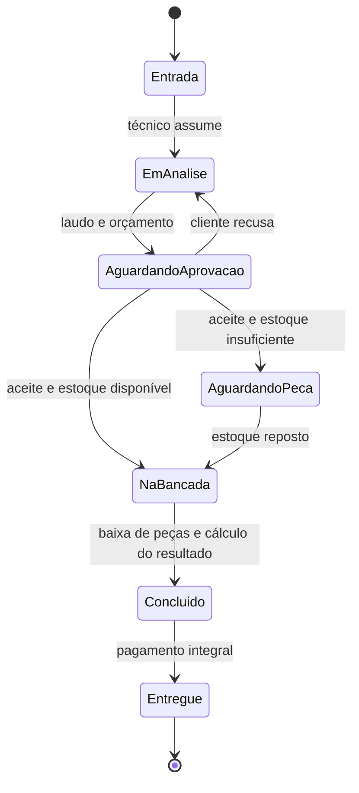

<p align="center"></p>

# ZirphasOS — Smart Repair Management

API de gestão de assistência técnica: da entrada do aparelho à entrega paga, com aprovação de orçamento, rastreabilidade de peças e resultado financeiro por serviço.

Quando a bancada e a recepção trabalham em planilhas diferentes, uma peça pode ser prometida duas vezes, um orçamento pode mudar depois da aprovação e um aparelho pode sair sem quitação. O ZirphasOS concentra essas decisões em regras de negócio verificáveis: cada transição da OS valida seus requisitos e os efeitos financeiros acontecem dentro da mesma transação do banco.

**Stack:** Python 3.12 · FastAPI · Pydantic 2 · SQLAlchemy 2 · PostgreSQL 17 · Alembic · JWT · Argon2 · pytest.

## O que cada pessoa pode fazer

| Perfil | Visão e operações |
| --- | --- |
| Administrador (`admin`) | Gerenciar funcionários, clientes, estoque e OS; atribuir técnicos; consultar indicadores de caixa, resultado, produtividade e estoque crítico. |
| Recepção (`front_desk`) | Cadastrar clientes e aparelhos, abrir OS com checklist, anexar fotos, registrar aceite do cliente e pagamentos, emitir recibo e entregar após quitação. |
| Técnico (`tech`) | Consultar a fila, assumir o aparelho, registrar laudo, montar orçamento, vincular peças e conduzir o reparo das OS sob sua responsabilidade. |
| Cliente | Acessar um link privado, acompanhar o status e aprovar ou recusar a versão apresentada do orçamento, sem criar conta. |

Funcionários usam JWT com expiração; senhas são armazenadas como hashes Argon2. O servidor consulta o usuário e suas permissões nas operações protegidas. Informações de custo, comissão e resultado ficam restritas ao administrador. O link do cliente funciona como uma credencial de acesso: o banco guarda seu hash, e o endereço completo é apresentado na abertura da OS. A recepção pode gerar outro link, revogando imediatamente o anterior.

## Workflow: status com consequências

O **State Pattern** está em [`app/core/os_state_machine.py`](app/core/os_state_machine.py). As classes de estado definem as transições possíveis; os serviços aplicam pré-condições, autorização, eventos e efeitos no estoque e no caixa. O administrador também respeita o ciclo de vida.



| Status da API | Regra principal |
| --- | --- |
| `intake` | Aparelho cadastrado com IMEI ou número de série e checklist físico obrigatório. |
| `analyzing` | Técnico responsável definido; orçamento e peças podem ser preparados. |
| `awaiting_approval` | Reparo bloqueado até uma decisão sobre a versão atual do orçamento. |
| `awaiting_parts` | Orçamento aceito, porém falta quantidade de pelo menos uma peça. |
| `repairing` | Orçamento aceito e condições para iniciar o reparo atendidas. |
| `completed` | Estoque baixado uma única vez; custo e resultado da OS registrados. |
| `delivered` | Saldo quitado; receita da OS registrada uma única vez no caixa. |

Uma recusa devolve a OS para análise. Alterações no orçamento invalidam o aceite anterior; a decisão inclui `quote_version` para impedir que um cliente aprove valores antigos. A disponibilidade é conferida novamente ao concluir: vincular uma peça **não reserva estoque**. Se outra OS consumir a última unidade, a conclusão falha sem deixar uma baixa parcial.

## Financeiro incorporado

Valores monetários usam `Decimal` e colunas `NUMERIC`, com duas casas decimais. Preço de venda e custo das peças são registrados na OS para preservar seu histórico.

```text
Valor total = mão de obra + soma(quantidade × preço de venda da peça)
Custo das peças = soma(quantidade × custo unitário da peça)
Resultado da OS = valor total − custo das peças − comissão
```

Exemplo: mão de obra de R$ 150,00 + tela vendida por R$ 200,00 = R$ 350,00. Com custo da tela de R$ 120,00 e comissão de R$ 30,00, o resultado registrado é **R$ 200,00**. Esse resultado segue a fórmula solicitada e não inclui aluguel, impostos, taxas de cartão ou outras despesas da empresa; portanto, não representa o lucro líquido contábil completo.

Pagamentos podem ser parciais, mas não podem ultrapassar o total aprovado. Cada registro inclui uma `idempotency_key`: repetir a mesma solicitação não duplica o pagamento. A entrega exige quitação e gera uma entrada única de caixa. **A política deste projeto reconhece a receita na entrega**, mesmo quando o pagamento foi registrado antes; o histórico de pagamentos conserva a data do recebimento. Não há integração com adquirentes, conciliação bancária, estorno, emissão fiscal ou livro-caixa de despesas.

No PostgreSQL, as alterações usam uma transação por requisição e bloqueios de linha nas operações concorrentes. Se qualquer validação falhar, a transação é revertida. Esse comportamento é relevante para duas conclusões simultâneas disputando a mesma peça.

## Executar com Docker

Pré-requisito: Docker Engine com Compose v2, ou Docker Desktop iniciado. Execute os comandos **dentro de `zirphas-os-backend`**.

### Preparar a configuração uma vez

No PowerShell, este bloco cria `.env` a partir do exemplo e gera valores independentes para a senha do banco e a chave JWT. Não substitua um `.env` já configurado.

```powershell
Copy-Item .env.example .env
$taskRng = [Security.Cryptography.RandomNumberGenerator]::Create()
$taskBytes = New-Object byte[] 32
$taskRng.GetBytes($taskBytes)
$taskDbSecret = [BitConverter]::ToString($taskBytes).Replace('-', '').ToLowerInvariant()
$taskRng.GetBytes($taskBytes)
$taskJwtSecret = [BitConverter]::ToString($taskBytes).Replace('-', '').ToLowerInvariant()
$taskRng.Dispose()
$taskEnvPath = Join-Path (Get-Location) '.env'
$taskConfig = [IO.File]::ReadAllText($taskEnvPath)
$taskConfig = $taskConfig.Replace('POSTGRES_PASSWORD=', "POSTGRES_PASSWORD=$taskDbSecret")
$taskConfig = $taskConfig.Replace('SECRET_KEY=', "SECRET_KEY=$taskJwtSecret")
[IO.File]::WriteAllText($taskEnvPath, $taskConfig)
```

Em Linux/macOS, copie com `cp .env.example .env` e preencha `POSTGRES_PASSWORD` e `SECRET_KEY` com dois valores distintos gerados por `openssl rand -hex 32`. A senha hexadecimal evita caracteres que precisariam ser escapados na URL de conexão. Nenhuma conta ou senha de administrador é predefinida.

### Subir banco e API em dois comandos

```console
docker compose up -d db
docker compose up --build -d api
```

A API espera o banco ficar saudável, aplica `alembic upgrade head` e inicia o Uvicorn. Banco e fotos possuem volumes persistentes. As portas são publicadas apenas em `127.0.0.1` por padrão.

- Swagger/OpenAPI: [http://localhost:8000/docs](http://localhost:8000/docs)
- Healthcheck: [http://localhost:8000/health](http://localhost:8000/health)
- Logs: `docker compose logs -f api`
- Encerrar sem apagar dados: `docker compose down`

Crie o primeiro administrador uma única vez:

```console
docker compose exec api python -m app.cli create-admin
```

O comando solicita nome, e-mail e senha com confirmação; a senha precisa de pelo menos 12 caracteres. Para automação, a CLI também aceita `ADMIN_NAME`, `ADMIN_EMAIL` e `ADMIN_PASSWORD` no ambiente. Credenciais não devem ser versionadas.

No Swagger, clique em **Authorize** e use seu e-mail no campo `username`. O administrador poderá criar os demais funcionários em `POST /api/v1/users`.

## Percorrer uma OS

1. Cadastre o cliente em `POST /api/v1/clients` e o aparelho em `POST /api/v1/clients/{client_id}/devices`.
2. Abra a OS em `POST /api/v1/orders`, informando o aparelho, defeito e checklist. Guarde o `tracking_url` retornado e compartilhe-o com o cliente.
3. Cadastre as peças do estoque. O técnico assume a OS, registra o laudo, define os valores e vincula as peças necessárias.
4. Envie o orçamento para aprovação. O cliente abre `/status/{token}` e decide; a recepção também pode registrar a decisão.
5. Conduza o reparo até `completed`: essa etapa baixa as peças e fixa o resultado do serviço.
6. Registre o pagamento integral ou suas parcelas. Faça a entrega para lançar a receita no caixa.

Exemplo de abertura, após cadastrar um aparelho de ID `1`:

```json
{
  "device_id": 1,
  "problem_description": "Tela quebrada e toque intermitente",
  "physical_checklist": {
    "powers_on": true,
    "screen_condition": "Trincada no canto inferior",
    "case_condition": "Marcas na lateral direita",
    "accessories": ["Capa transparente"],
    "notes": "Sem carregador; cliente presente na conferência"
  }
}
```

## Superfície da API

Os esquemas completos, métodos disponíveis e respostas estão no Swagger gerado pela aplicação.

| Caminho | Uso |
| --- | --- |
| `POST /api/v1/auth/token` | Login OAuth2 por formulário, com `username` = e-mail. |
| `/api/v1/users` | Funcionários e permissões, restritos ao administrador. |
| `/api/v1/clients` | Cadastro e consulta de clientes. |
| `/api/v1/clients/{client_id}/devices` | Aparelhos vinculados ao cliente. |
| `/api/v1/inventory` | Peças, quantidades e preços. |
| `/api/v1/orders` | OS, estados, orçamento, peças, anexos, pagamentos e recibos. |
| `GET /api/v1/dashboard` | Indicadores administrativos. |
| `GET /api/v1/public/status/{token}` | Projeção pública da OS por link privado. |
| `POST /api/v1/public/status/{token}/decision` | Aceite ou recusa da versão do orçamento. |
| `GET /status/{token}` | Portal do cliente, com atualização automática a cada 10 segundos. |

O portal externo consulta a API periodicamente; esta versão não usa WebSocket. O frontend interno é a documentação interativa da API: não há um painel web completo para funcionários.

As ações de uma OS usam o prefixo `/api/v1/orders/{order_id}`:

| Método e sufixo | Corpo ou resultado |
| --- | --- |
| `POST /assign` | `{"tech_id": 2}`; atribuição pelo administrador. |
| `POST /transition` | `{"status": "analyzing"}`; o técnico pode assumir uma entrada sem responsável. |
| `PUT /quote` | `labor_amount`, `technical_report` e, para o administrador, `commission_amount`. |
| `PUT /parts/{part_id}` | `{"quantity": 1}`; quantidade zero remove a peça durante a análise. |
| `POST /decision` | `{"approved": true, "quote_version": 1}`; registro pela recepção. |
| `POST /payments` | `amount`, `method` e `idempotency_key`; métodos: `cash`, `pix`, `credit_card`, `debit_card`, `bank_transfer`. |
| `POST /attachments` | Formulário multipart com campo `file`: JPEG, PNG ou WebP; até 20 fotos por OS. |
| `GET /attachments/{attachment_id}` | Download autenticado da foto. |
| `GET /receipt` | Recibo não fiscal em HTML, imprimível pelo navegador. |
| `POST /tracking-link` | Gera outro `tracking_url` e revoga o anterior. |

## Arquitetura e dados

```text
zirphas-os-backend/
├── app/
│   ├── api/
│   │   ├── dependencies.py      # Sessão transacional, autenticação e RBAC
│   │   └── v1/endpoints/        # Auth, usuários, clientes, estoque, OS e público
│   ├── core/
│   │   ├── config.py            # Configuração por ambiente
│   │   ├── security.py          # Argon2 e JWT
│   │   └── os_state_machine.py  # Estados e transições permitidas
│   ├── models/                 # Entidades e restrições SQLAlchemy
│   ├── schemas/                # Entradas e saídas Pydantic
│   ├── services/               # Regras de negócio e efeitos transacionais
│   ├── cli.py                  # Criação explícita do primeiro administrador
│   ├── db.py                   # Engine e sessões
│   └── main.py                 # Aplicação FastAPI
├── alembic/                    # Migrações versionadas
├── tests/                      # Testes de domínio e integração
├── docs/logo.svg
├── scripts/start.sh            # Migração + servidor
├── requirements.in             # Dependências diretas fixadas
├── requirements.txt            # Dependências resolvidas, incluindo transitivas
├── requirements-dev.txt
├── Dockerfile
└── docker-compose.yml
```

As tabelas centrais são `users`, `clients`, `devices`, `parts_inventory`, `service_orders` e `os_parts`. A modelagem também inclui pagamentos, entradas de caixa, anexos e eventos da OS. Chaves estrangeiras preservam os vínculos; constraints ajudam a impedir quantidades inválidas e lançamentos duplicados.

As rotas tratam HTTP e aplicam as permissões. Os schemas validam o contrato de entrada e saída. Os serviços coordenam a regra de negócio e a máquina de estados. A dependência de banco confirma ou reverte toda a requisição.

## Desenvolvimento e testes

Para executar a API fora do Docker, instale Python 3.12, configure `DATABASE_URL` em `.env` apontando para `localhost` e mantenha a mesma senha de PostgreSQL. Crie um ambiente virtual e instale as dependências:

```powershell
python -m venv .venv
.\.venv\Scripts\python.exe -m pip install -r requirements-dev.txt
docker compose up -d db
.\.venv\Scripts\python.exe -m alembic upgrade head
.\.venv\Scripts\python.exe -m uvicorn app.main:app --reload --no-access-log
```

Não é necessário ativar o ambiente virtual no PowerShell. Em Linux/macOS, use `.venv/bin/python` nos mesmos comandos.

```powershell
.\.venv\Scripts\python.exe -m pytest -q
```

Os testes verificam transições, autorizações, aceite versionado, efeitos financeiros e isolamento do portal. SQLite é usado na suíte rápida e não reproduz os bloqueios de linha do PostgreSQL. Para incluir os cenários de concorrência, defina `TEST_POSTGRES_URL` com a URL de um banco PostgreSQL de testes; eles usam um schema isolado e temporário. Sem essa variável, esses cenários são ignorados. A CI em [`.github/workflows/ci.yml`](../.github/workflows/ci.yml) aplica as migrações e executa a suíte com PostgreSQL, disponibilizando o relatório de testes como artefato.

`requirements.txt` e `requirements-dev.txt` fixam versões diretas e transitivas. Para uma atualização deliberada, edite os arquivos `.in`, gere novamente com `uv pip compile --universal --python-version 3.12` e rode a suíte.

Os resultados e limites da verificação local estão em [docs/VALIDATION.md](docs/VALIDATION.md).

## Escopo desta versão

Este é um backend demonstrável para **uma assistência técnica**, com portal público. Não há isolamento entre empresas nem suporte a SaaS multi-tenant. Também não há cancelamento definitivo de OS, notificações por WhatsApp/e-mail, assinatura digital, reserva antecipada de estoque ou processamento de pagamentos.

O Compose atende desenvolvimento e avaliação local. Uma publicação real exige configuração do domínio em `PUBLIC_BASE_URL`, HTTPS, gestão de segredos, backup de banco e uploads, observabilidade e proteção contra abuso no ponto de entrada. O projeto não se apresenta como uma solução de produção pronta.

## Referências técnicas

- [FastAPI: OAuth2, JWT e hashing de senhas](https://fastapi.tiangolo.com/tutorial/security/oauth2-jwt/)
- [SQLAlchemy: bloqueios com `with_for_update`](https://docs.sqlalchemy.org/en/20/core/selectable.html#sqlalchemy.sql.expression.Select.with_for_update)
- [Alembic: migrações e atualização do banco](https://alembic.sqlalchemy.org/en/latest/tutorial.html)
